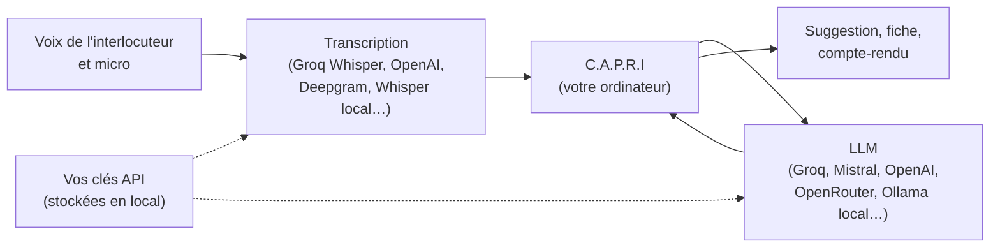

<p align="center">
  
</p>

<p align="center">
  <strong>Un copilote commercial pour Windows qui écoute vos appels et vous souffle quoi dire, au bon moment.</strong>
</p>

<p align="center">
  <a href="https://github.com/GreatSw0rd/C.A.P.R.I/releases/tag/capri-latest"><strong>Télécharger pour Windows</strong></a>
</p>


## Ce que fait C.A.P.R.I

C.A.P.R.I s'affiche dans une petite fenêtre transparente, toujours au premier plan, par-dessus votre visio ou votre logiciel d'appel. Il accompagne le rendez-vous du début à la fin.


<sub>Captures du rendez-vous réalisées avec un prospect fictif.</sub>

**Avant l'appel**
- Une fiche de préparation : questions SPIN à poser, objections probables, points clés.
- Une base de connaissances (offre, tarifs, réponses aux objections) sur laquelle l'IA s'appuie.

**Pendant l'appel**
- Il écoute votre interlocuteur (son de l'ordinateur) et vous (micro), puis transcrit.
- Il tient une **fiche vivante** : chaque information est notée avec la citation exacte du client, puis classée par étape SPIN et critère de qualification (budget, décideur, besoin, délai).
- Il propose **une seule suggestion à la fois** : la phrase à dire maintenant et les questions de relance.
- Il suit les objections, les questions posées et les engagements pris.

**Après l'appel**
- Un rappel de ce qui n'a pas été abordé, avant de raccrocher.
- Un compte-rendu prêt pour le CRM et un **e-mail de relance** prêt à envoyer.

| Questions en direct | Compte-rendu et e-mail de relance |
|---|---|
|  |  |

## Fonctionnalités

- **Copilote de rendez-vous** : préparation, fiche vivante, suggestion du moment, suivi des objections et des engagements, compte-rendu.
- **Questions à l'IA** à l'écrit, à la dictée, ou en **conversation vocale** (l'IA répond à voix haute).
- **Captures d'écran** jointes à la question, en plein écran ou par zone, sur plusieurs écrans.
- **Prompts système** à activer en un clic depuis l'overlay (vente SPIN, négociation…).
- **Choix du modèle** depuis l'overlay, parmi les LLM que vous avez ajoutés.
- **Connaissances** : vos documents injectés dans les réponses.
- **Raccourcis clavier globaux**, actifs même quand la visio est au premier plan.
- **Interface en français**, réponses en police de lecture, orbe animée en WebGL qui réagit à la voix.

## Vous branchez vos propres clés

C.A.P.R.I n'a pas de serveur. Il appelle directement les services que vous choisissez, avec vos propres clés. Il n'y a ni abonnement imposé, ni télémétrie, et l'historique reste sur votre ordinateur (SQLite).



Avec **une seule clé Groq** (offre gratuite disponible), on couvre à la fois la transcription (`whisper-large-v3-turbo`) et les réponses (`openai/gpt-oss-120b`). Avec Ollama, tout peut tourner en local, sans Internet.

## Informer votre interlocuteur

**Avant d'écouter ou d'enregistrer un appel, prévenez votre interlocuteur et obtenez son accord.** C'est une obligation légale dans de nombreux pays (en Europe, le RGPD s'applique aux données vocales). Vous êtes responsable de l'usage que vous faites de l'outil.

## Installation

### Télécharger (le plus simple)

1. Téléchargez l'installeur `C.A.P.R.I_x.y.z_x64-setup.exe` sur la page [**Releases**](https://github.com/GreatSw0rd/C.A.P.R.I/releases/tag/capri-latest).
2. Lancez-le. L'installeur n'est pas signé : Windows peut afficher « Windows a protégé votre ordinateur ». Cliquez alors sur « Informations complémentaires », puis sur « Exécuter quand même ».
3. Dans le tableau de bord, page **Fournisseurs d'IA** :
   - **LLM** : « Ajouter un LLM », puis « Remplissage auto », puis « Groq · texte rapide ». Enregistrez, choisissez-le, et collez votre clé.
   - **Transcription** : choisissez « Groq Whisper », collez la même clé, modèle `whisper-large-v3-turbo`.

### Compiler depuis les sources

Prérequis :
- Windows 10 ou 11, avec WebView2 (déjà présent sur Windows 11)
- [Node.js](https://nodejs.org) 20 ou plus
- [Rust](https://rustup.rs) (stable)
- [Microsoft C++ Build Tools](https://visualstudio.microsoft.com/visual-cpp-build-tools/), charge de travail « Développement Desktop en C++ »

```bash
npm ci
```

```bash
npm run tauri dev
```

Pour produire l'installeur (dans `src-tauri/target/release/bundle/nsis/`) :

```bash
npm run tauri build
```

Chaque push sur `main` déclenche aussi un build Windows dans GitHub Actions, qui met à jour la page de téléchargement.

## Architecture

- **Tauri 2 + Rust** : fenêtres (overlay transparent, tableau de bord), capture audio système (WASAPI) et micro (cpal), captures d'écran multi-écrans (xcap), raccourcis globaux, SQLite.
- **React 19 + TypeScript + Tailwind 4** : interface, appels aux LLM en streaming à partir de modèles de requête curl configurables.
- **Détection de parole** dans le navigateur (VAD), transcription par le service choisi, synthèse vocale avec les voix de Windows.
- **WebGL** : orbe animée, alimentée par l'activité de la conversation.

## Licence et crédits

- C.A.P.R.I est dérivé de [Pluely](https://github.com/iamsrikanthnani/pluely) 0.1.9 de Srikanth Nani, et distribué comme lui sous licence **GPL-3.0**. Voir [`LICENSE`](LICENSE) et [`NOTICE`](NOTICE).
- L'animation de l'orbe s'inspire du shader « Phosphor 3 » de [XorDev](https://github.com/XorDev).
- Le nom et l'œil font référence à Capri, de *Cyberpunk Edgerunners*.
