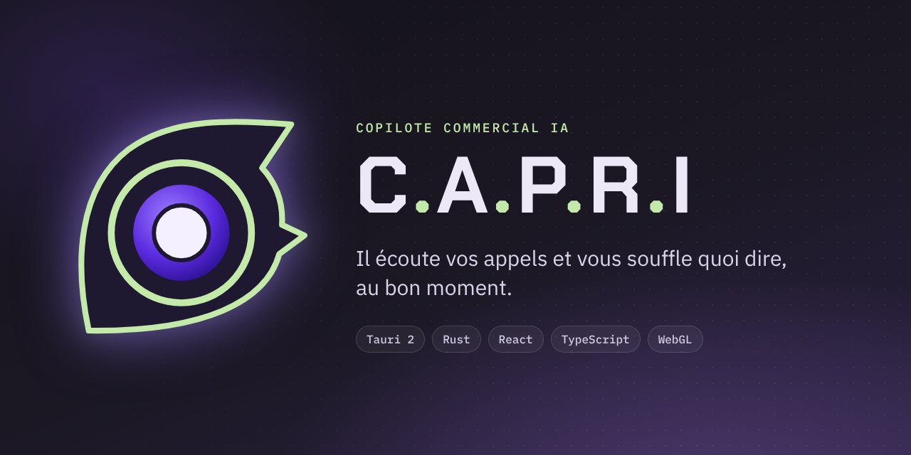
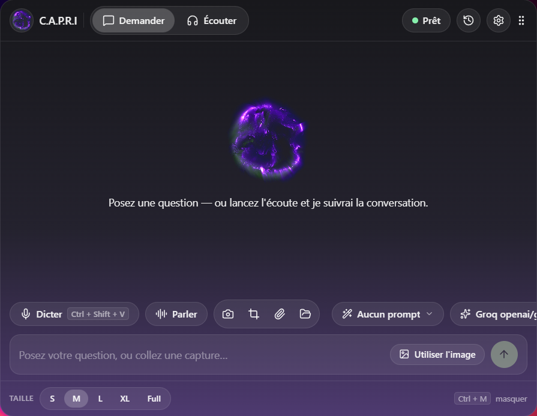
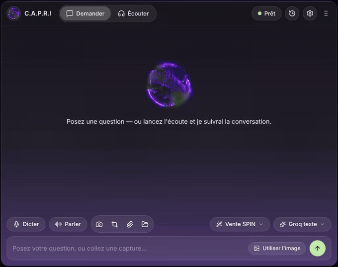
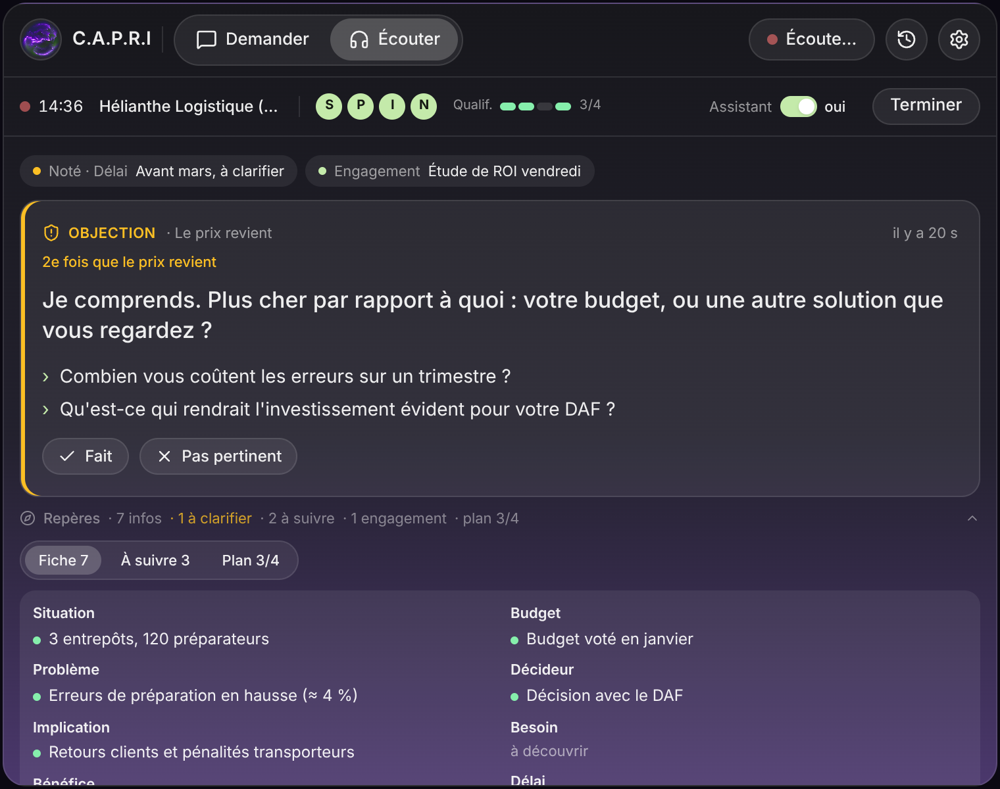
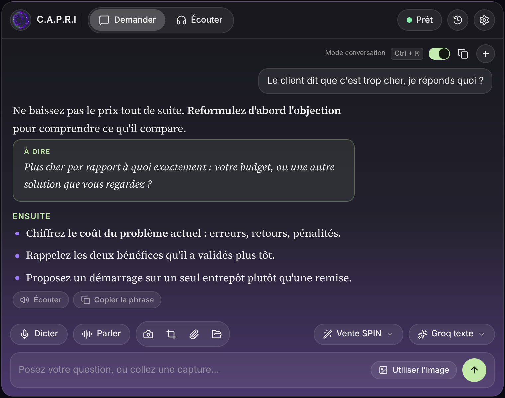
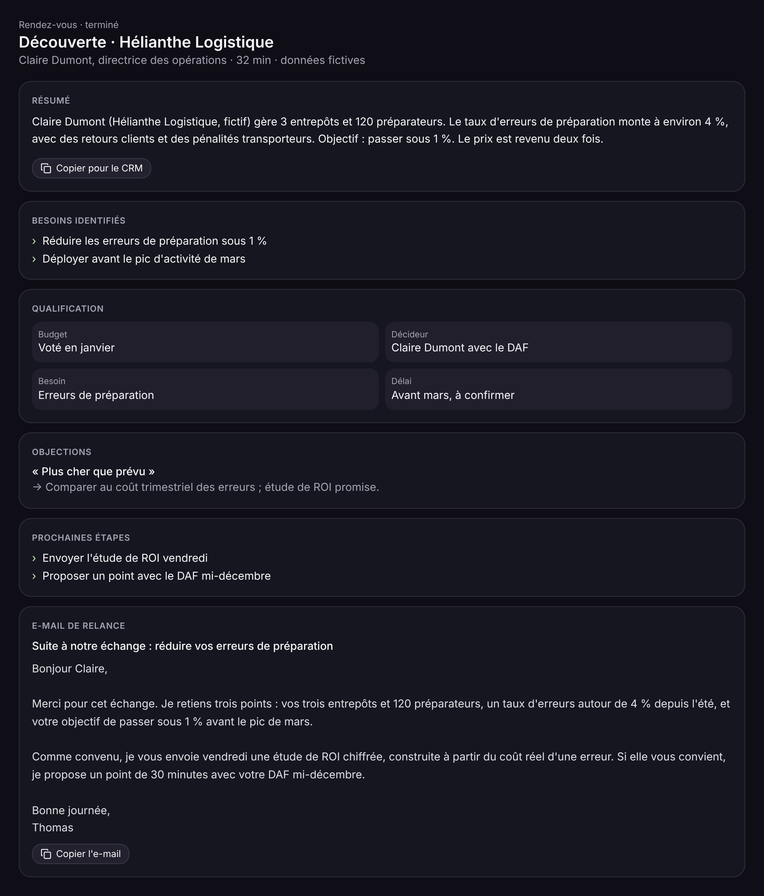
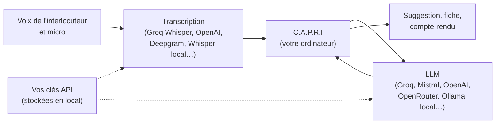

<p align="center">
  
</p>

<p align="center">
  <strong>Un copilote commercial pour Windows qui écoute vos appels et vous souffle quoi dire, au bon moment.</strong>
</p>

<p align="center">
  <a href="https://github.com/GreatSw0rd/C.A.P.R.I/releases/tag/capri-latest"><strong>Télécharger pour Windows</strong></a>
</p>



## Démo

<p align="center">
  
</p>

<p align="center"><sub>Une question à l'IA, puis l'écoute d'un appel : suggestion du moment et fiche vivante. Prospect fictif.</sub></p>

## Ce que fait C.A.P.R.I

C.A.P.R.I s'affiche dans une petite fenêtre transparente, toujours au premier plan, par-dessus votre visio ou votre logiciel d'appel. Il accompagne le rendez-vous du début à la fin.



<sub>Captures du rendez-vous réalisées avec un prospect fictif.</sub>

**Avant l'appel**
- Une fiche de préparation : questions SPIN à poser, objections probables, points clés.
- Une base de connaissances (offre, tarifs, réponses aux objections) sur laquelle l'IA s'appuie.

**Pendant l'appel**
- Il écoute votre interlocuteur (son de l'ordinateur) et vous (micro), puis transcrit.
- Il tient une **fiche vivante** : chaque information est notée avec la citation exacte du client, puis classée par étape SPIN et critère de qualification (budget, décideur, besoin, délai).
- Il propose **une seule suggestion à la fois** : la phrase à dire maintenant et les questions de relance.
- Il suit les objections, les questions posées et les engagements pris.

**Après l'appel**
- Un rappel de ce qui n'a pas été abordé, avant de raccrocher.
- Un compte-rendu prêt pour le CRM et un **e-mail de relance** prêt à envoyer.

| Questions en direct | Compte-rendu et e-mail de relance |
|---|---|
|  |  |

## Fonctionnalités

**Copilote de rendez-vous**
- Préparation, fiche vivante avec citations, suggestion du moment, suivi des objections, des questions et des engagements, rappel de fin d'appel, compte-rendu et e-mail de relance.
- Interrupteur « Assistant oui / non » : sans assistant, C.A.P.R.I prend des notes et rédige le compte-rendu, sans rien afficher pendant l'appel.

**Questions à l'IA**
- À l'écrit, à la **dictée**, ou en **conversation vocale** (bouton « Parler ») : vous parlez, l'IA répond à voix haute, puis se remet à l'écoute.
- Bouton **« Écouter »** sous chaque réponse (voix françaises de Windows, gratuites et hors ligne) et bouton **« Copier la phrase »** pour la phrase à dire mot pour mot.
- Réponses mises en forme pour la lecture rapide : police Source Serif, phrase à dire dans un encadré, listes aérées.
- **Captures d'écran** jointes à la question, en plein écran ou par zone, sur plusieurs écrans. Si le LLM ne lit pas les images, la question est renvoyée sans la capture.

**Personnalisation**
- **Prompts système** à activer ou désactiver en un clic depuis l'overlay, avec le choix de ceux qui y apparaissent.
- **Choix du LLM** depuis l'overlay, parmi ceux que vous avez ajoutés. Modèles prêts à l'emploi : Groq (texte ou images), Mistral, OpenAI, OpenRouter, Ollama.
- **Connaissances** : vos documents (offre, tarifs, objections) injectés dans les réponses.
- **Effets visuels** réglables (complets, légers, aucun) pour les PC peu puissants.

**Confort**
- Overlay transparent, toujours au premier plan, en cinq tailles (S à Full), déplaçable au clavier.
- Interface entièrement en français.
- Orbe animée en WebGL (shader de filaments lumineux) qui s'emballe quand quelqu'un parle et pulse pendant les réponses.

## Raccourcis clavier

Globaux, ils fonctionnent même quand la visio est au premier plan. Valeurs par défaut sous Windows, modifiables dans le tableau de bord (« Curseur et raccourcis ») :

| Action | Raccourci |
|---|---|
| Afficher / masquer l'overlay | `Ctrl` + `\` |
| Ouvrir / fermer le tableau de bord | `Ctrl` + `Maj` + `D` |
| Aller à la zone de saisie | `Ctrl` + `Maj` + `I` |
| Lancer / arrêter l'écoute | `Ctrl` + `Maj` + `M` |
| Dicter | `Ctrl` + `Maj` + `A` |
| Capture d'écran | `Ctrl` + `Maj` + `S` |
| Déplacer l'overlay | `Ctrl` + flèches |

## Vous branchez vos propres clés

C.A.P.R.I n'a pas de serveur. Il appelle directement les services que vous choisissez, avec vos propres clés. Il n'y a ni abonnement imposé, ni télémétrie, et l'historique reste sur votre ordinateur (SQLite).



Avec **une seule clé Groq** (offre gratuite disponible), on couvre à la fois la transcription (`whisper-large-v3-turbo`) et les réponses (`openai/gpt-oss-120b`). Avec Ollama, les réponses peuvent tourner en local, sans Internet. La voix de l'IA utilise les voix installées dans Windows : aucune clé supplémentaire.

## Informer votre interlocuteur

**Avant d'écouter ou d'enregistrer un appel, prévenez votre interlocuteur et obtenez son accord.** C'est une obligation légale dans de nombreux pays (en Europe, le RGPD s'applique aux données vocales). Vous êtes responsable de l'usage que vous faites de l'outil.

## Installation

### Télécharger (le plus simple)

1. Téléchargez l'installeur `C.A.P.R.I_x.y.z_x64-setup.exe` sur la page [**Releases**](https://github.com/GreatSw0rd/C.A.P.R.I/releases/tag/capri-latest).
2. Lancez-le. L'installeur n'est pas signé : Windows peut afficher « Windows a protégé votre ordinateur ». Cliquez alors sur « Informations complémentaires », puis sur « Exécuter quand même ».
3. Dans le tableau de bord, page **Fournisseurs d'IA** :
   - **LLM** : « Ajouter un LLM », puis « Remplissage auto », puis « Groq · texte rapide ». Enregistrez, choisissez-le, et collez votre clé.
   - **Transcription** : choisissez « Groq Whisper », collez la même clé, modèle `whisper-large-v3-turbo`.

### Compiler depuis les sources

Prérequis :
- Windows 10 ou 11, avec WebView2 (déjà présent sur Windows 11)
- [Node.js](https://nodejs.org) 20 ou plus
- [Rust](https://rustup.rs) (stable)
- [Microsoft C++ Build Tools](https://visualstudio.microsoft.com/visual-cpp-build-tools/), charge de travail « Développement Desktop en C++ »

```bash
npm ci
```

```bash
npm run tauri dev
```

Pour produire l'installeur (dans `src-tauri/target/release/bundle/nsis/`) :

```bash
npm run tauri build
```

Chaque push sur `main` déclenche aussi un build Windows dans GitHub Actions, qui met à jour la page de téléchargement.

## Limites connues

- **Windows uniquement** : le code vient d'un projet multiplateforme, mais C.A.P.R.I n'a été testé que sous Windows.
- L'installeur n'est **pas signé** : Windows affiche un avertissement au premier lancement.
- Les modèles de LLM évoluent vite : les noms proposés par « Remplissage auto » peuvent être retirés par le fournisseur. Vérifiez la liste à jour chez lui (par exemple [console.groq.com/docs/models](https://console.groq.com/docs/models)).
- La qualité des suggestions dépend du LLM choisi et de la qualité de la transcription.
- La voix de l'IA est celle de Windows : correcte, mais moins naturelle qu'un service de voix en ligne. Pour la conversation vocale, un casque évite que le micro entende la réponse.

## Architecture

- **Tauri 2 + Rust** : fenêtres (overlay transparent, tableau de bord), capture audio système (WASAPI) et micro (cpal), captures d'écran multi-écrans (xcap), raccourcis globaux, SQLite.
- **React 19 + TypeScript + Tailwind 4** : interface, appels aux LLM en streaming à partir de modèles de requête curl configurables.
- **Détection de parole** dans le navigateur (VAD), transcription par le service choisi, synthèse vocale avec les voix de Windows.
- **WebGL** : orbe animée, alimentée par l'activité de la conversation.

## Licence et crédits

- C.A.P.R.I est dérivé de [Pluely](https://github.com/iamsrikanthnani/pluely) 0.1.9 de Srikanth Nani, et distribué comme lui sous licence **GPL-3.0**. Voir [`LICENSE`](LICENSE) et [`NOTICE`](NOTICE).
- L'animation de l'orbe s'inspire du shader « Phosphor 3 » de [XorDev](https://github.com/XorDev).
- Le nom et l'œil font référence à Capri, de *Cyberpunk Edgerunners*.
